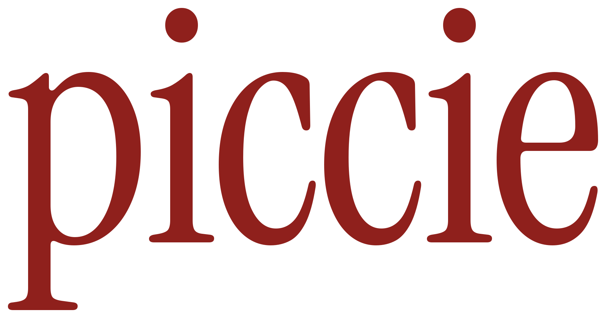
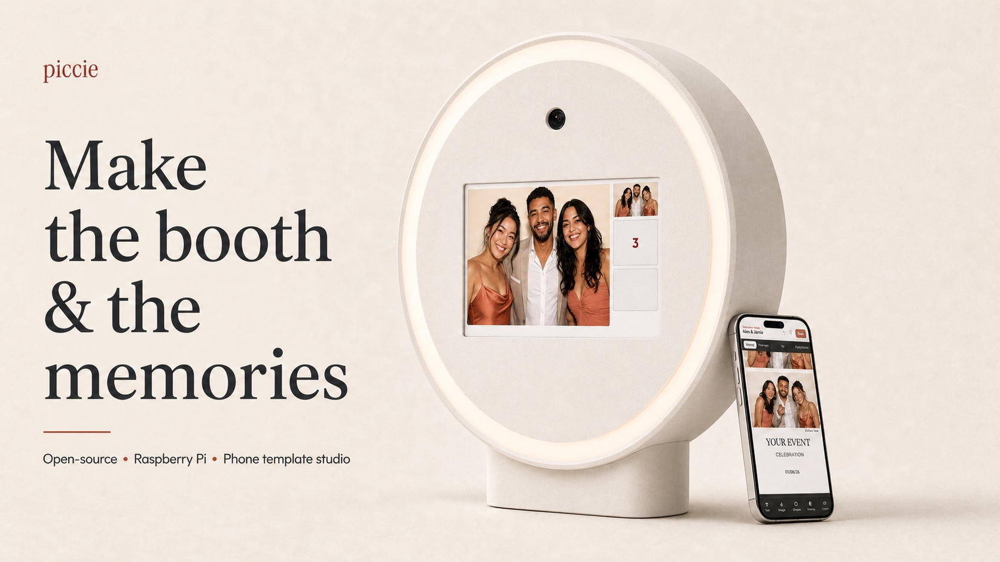
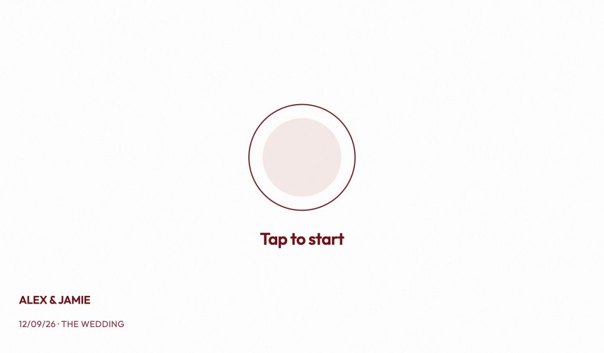
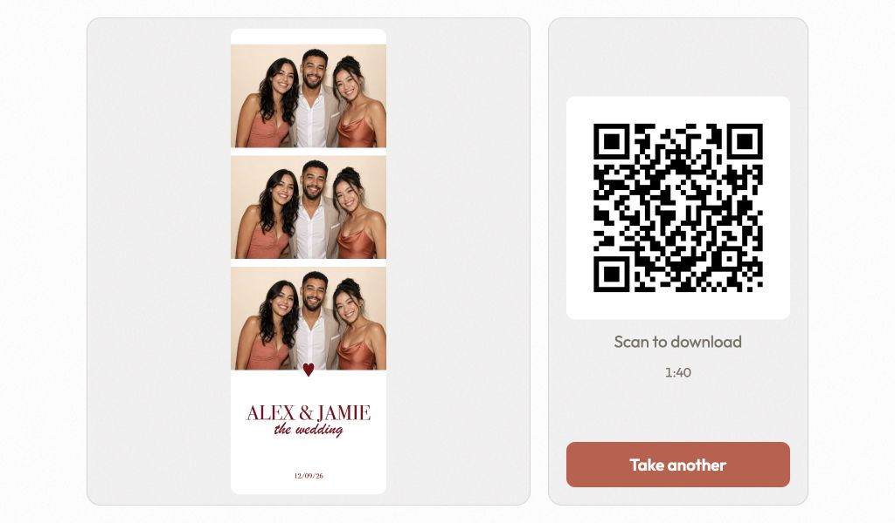
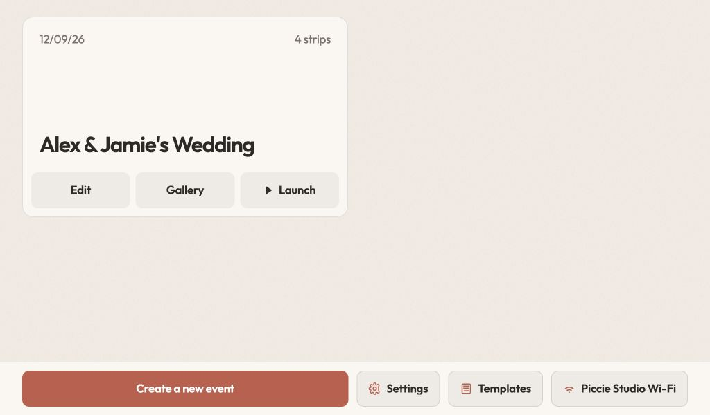
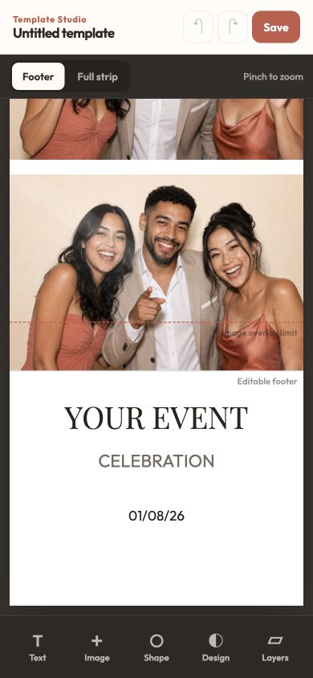

  

<strong>Make the booth &amp; the memories</strong>

  The open-source photo booth you build yourself. 
  Guests take three photos, scan a code, and the strip is on their own phone.

  
  
  
  

## Why Piccie

- **Easy to set up.** Flash one file to a microSD card. The only thing you type
  on the booth is the Wi-Fi password. You finish setup on your phone in about
  five minutes.
- **Guests love it.** Tap, smile three times, scan. The strip downloads over
  mobile data. No app, no sign-up, and nobody has to join the booth's Wi-Fi.
- **You own it.** Photos go to your own Cloudflare storage, which is free for
  most parties. Design your own strips. MIT licence, no subscription.

## See it in action

| Start a session | Take photos | Download the strip |
| --- | --- | --- |
|  |  |  |

| Your events on the booth | Design strips on your phone |
| --- | --- |
|  |  |

## What you get

**For guests**

- A big "Tap to start" screen, a countdown ring, three photos and a finished
  strip in seconds.
- A QR code that downloads their strip straight to their phone, where it
  slides out of a little printer.
- Nothing to install and no network to join.

**For you**

- **Events.** Give each party a name, a date and an end time. The heading and
  date print on every strip.
- **Template Studio.** Design strips on your phone: text, images, shapes and
  three photo slots. Classic and Love templates are included.
- **Photo looks.** Clean, Soft, Warm, Mono or Bold, with a strength slider and
  a live preview.
- **Share the whole event.** One QR code downloads every strip and original
  photo as a single ZIP.
- **Guest mode stays locked.** Leaving it needs five taps in the corner and
  your four-digit PIN.

**Under the hood**

- Runs on a Raspberry Pi 4, an IMX708 camera and a 7-inch touchscreen.
- Keeps working when Wi-Fi drops. Photos wait on the booth and upload when the
  connection returns.
- The system files are read-only and photos are saved safely, so a pulled
  plug won't break the booth.
- Optional short links on your own domain give smaller QR codes that never
  expire.
- Updates install over Wi-Fi and roll back by themselves if anything fails.
- An eight-hour soak test proves the booth before a real event.

## Build your own in five steps

1. **Get the parts.** See the [hardware list](docs/hardware.md).
2. **Flash the image** to a microSD card with Raspberry Pi Imager.
   [Getting started](docs/getting-started.md)
3. **Make a Cloudflare storage bucket** for the photos. It takes about five
   minutes. [Cloudflare storage](docs/cloudflare.md)
4. **Turn the booth on**, pick your Wi-Fi, then finish setup on your phone.
   [Getting started](docs/getting-started.md#3-turn-it-on-and-pick-wi-fi)
5. **Create an event and press Launch.**
   [Running an event](docs/running-an-event.md)

## Guides

| Guide | What it covers |
| --- | --- |
| [Getting started](docs/getting-started.md) | Flash the card, join Wi-Fi, finish setup on your phone, take a test strip |
| [Cloudflare storage](docs/cloudflare.md) | Create the photo bucket and key, and optionally use your own domain for short links |
| [Running an event](docs/running-an-event.md) | Create events, launch guest mode, share the photos, shut down safely |
| [Templates](docs/templates.md) | Design your own strips with Template Studio |
| [Troubleshooting](docs/troubleshooting.md) | What each warning means and how to fix it |
| [Advanced](docs/advanced.md) | Build the image yourself, update over SSH, run the soak test, develop locally |
| [Hardware](docs/hardware.md) | Parts list and printed parts |

## Project status

The software is ready to use and is tested on the Raspberry Pi 4 Model B
reference booth. The hardware release is still in progress: the STL files,
fastener list and photographed assembly guide are coming soon. Star or watch
the repository to hear when they land.

## Contributing and licence

Built one? Show it off in
[Show and tell](https://github.com/BananaStems/piccie/discussions/categories/show-and-tell).
Stuck or found a bug? Open an
[issue](https://github.com/BananaStems/piccie/issues/new/choose). To work on the
code, read [CONTRIBUTING.md](CONTRIBUTING.md).

Piccie is released under the [MIT licence](LICENSE). Font licences are listed in
[THIRD_PARTY_NOTICES.md](THIRD_PARTY_NOTICES.md).
