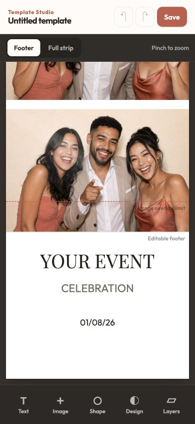

# Templates

A template is the design around the three photos: colours, text, images and
shapes. Piccie comes with two:

- **Classic**: warm cream with gold accents.
- **Love**: white with burgundy serif and script lettering.

You can design your own on your phone with **Template Studio**.

## Design a template

1. On the booth's main menu, select **Templates**, then **Create on phone**.
2. Scan the QR code with your phone. Your phone must be on the same Wi-Fi as
   the booth.
3. Template Studio opens with a blank strip. **Tap anything on the strip to
   edit it**, or add text, images and shapes from the bar at the bottom.
4. Move the three photo slots, change the background, add a logo or a
   monogram. **Layers** shows what sits in front: the top of the list is in
   front.
5. Give the template a name and select **Keep this design**. It appears on the
   booth straight away.

### Text that changes per event

Some text boxes fill in from each event's details: the **Heading**, the
**Subheading** and the **date**. Design a template once and reuse it for every
event; each strip prints that event's names and date.

## Use a template

Pick it in the event's **Template** field when you create or edit an event. See
[Running an event](running-an-event.md#1-create-the-event).

## Archive or delete

On the booth's **Templates** screen, tap one of your own templates. The
built-in ones can't be changed.

- **Archive** hides it from the list but keeps it. Find it again under
  **Archived** and select **Restore**.
- **Delete** removes it for good. It only appears when no event uses the
  template; **Used in** shows which events do.
